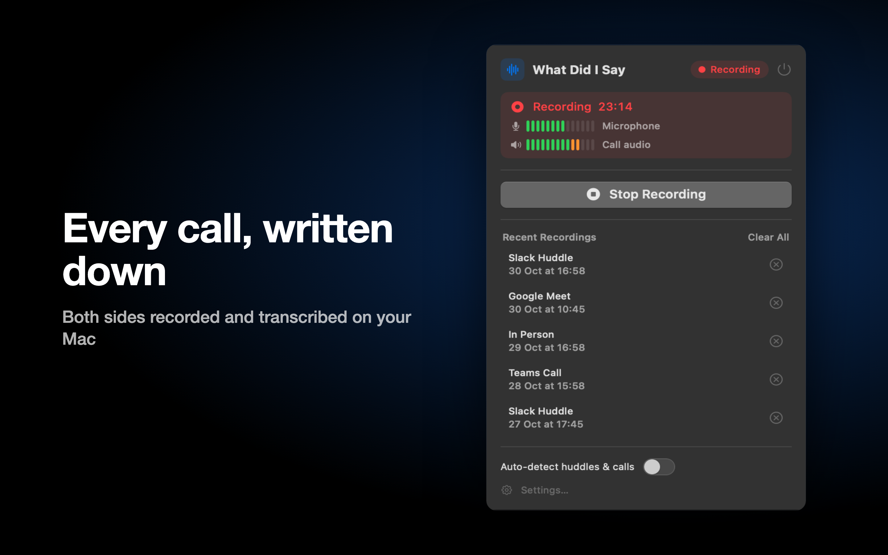
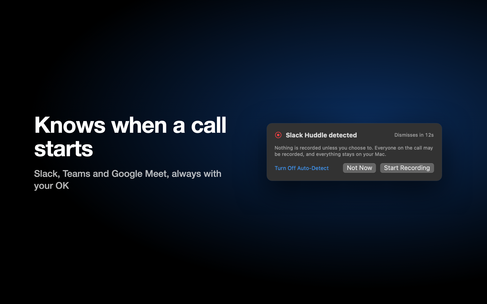
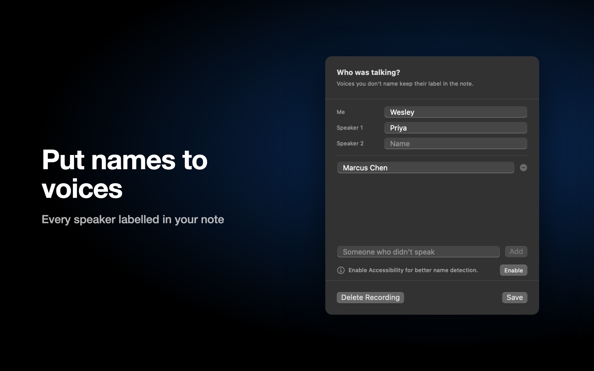
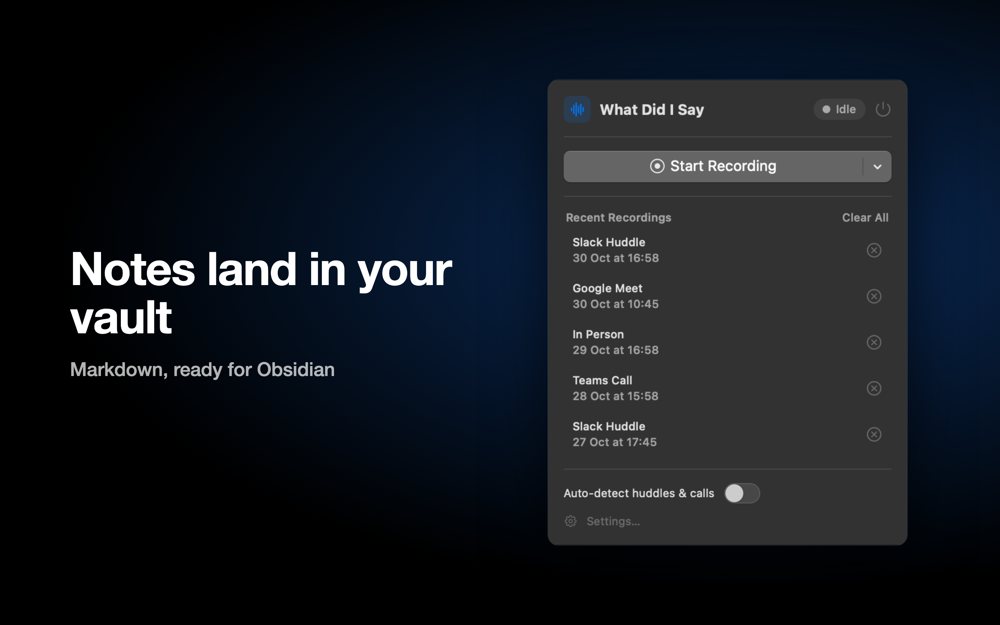

# What Did I Say

macOS menu-bar app that detects Slack huddles / Teams calls / Google Meet (in the browser), records both sides, transcribes locally with WhisperKit, and writes a markdown note to your Obsidian vault. It also records in-person meetings from the laptop microphone alone.

See [DESIGN.md](DESIGN.md) for the full design and [PRODUCT.md](PRODUCT.md) for the product overview.

<p>
  
  
  
  
</p>

## Requirements

- Apple Silicon, macOS 14+
- Xcode 16+ / Swift 6 toolchain

## Build & run

```sh
./Scripts/setup-signing.sh   # once per machine
./Scripts/bundle.sh release
open build/WhatDidISay.app
```

Lint with `./Scripts/lint.sh` (swift-format, config in `.swift-format`); `./Scripts/lint.sh --fix` formats in place first.

`bundle.sh` compiles the executable, wraps it in a `.app`, and signs it with the hardened runtime via `Scripts/sign.sh`.

`setup-signing.sh` creates a self-signed "WhatDidISay Local Signing" certificate in the login keychain. Every build signed with it gets the same designated requirement (bundle id plus certificate), so macOS keeps Microphone and Screen Recording grants across rebuilds. Without it, `sign.sh` falls back to ad-hoc signing, which ties grants to the binary hash and re-prompts after every build. Override the identity with `SIGN_IDENTITY="..."`. The certificate is only meant for local builds: other Macs still need a Developer ID signature and notarization.

On first use, grant the permissions macOS prompts for:

- **Microphone** — records your side, and the whole room for in-person meetings
- **Screen Recording** — required for ScreenCaptureKit to capture the other participants' audio. Only calls need it; recording the room works with the microphone alone.

## Usage

1. Click the waveform menu-bar icon.
2. Set **Vault** to your Obsidian vault (or any folder) and pick a Whisper **Model** (`base` is a good default; `large-v3` is most accurate).
3. **Manual:** click *Start Recording* / *Stop Recording*. The chevron beside it offers *Record a Call* (both sides) and *Record the Room* for an ad-hoc in-person meeting, which captures the microphone only.
4. **Auto:** toggle *Auto-detect huddles & calls*. When your mic goes live while Slack or Teams is running — or a browser has a live Google Meet tab open — a countdown prompt appears; click *Start Recording* to begin. If you do nothing, the prompt dismisses after 15 seconds and nothing is recorded. Recording stops when the mic goes quiet.

   Google Meet detection uses Accessibility to spot a tab whose title carries a Meet meeting code (`abc-defg-hij`), so a browser that's merely open won't trigger a prompt. Grant Accessibility if macOS prompts for it; without it, Meet calls still record via *Start Recording* manually. Capture targets the host browser's audio, so audio from that browser's other tabs can bleed into the recording.

While recording, a small floating panel shows the elapsed time, live mic and call-audio meters, and a warning if either track stops writing mid-call. It sits above every Space, full-screen apps included, without stealing focus. Turn it off with *Show recording panel* in Settings.

Notes are written as `YYYY-MM-DD HHMM <Source>.md` with YAML frontmatter and a `Me` / `Others` labeled transcript.

In-person recordings have no second track to tell you apart from everyone else, so every voice in the room is diarized into `Speaker 1`, `Speaker 2`, … and the review dialog lets you name each one. Naming a voice relabels it throughout the transcript; voices you leave unnamed keep their label and stay out of the participant list.

## Screenshots

`screenshots/` holds App Store images: `raw/mac/` are the views themselves, `framed/mac/` are 2880×1800 marketing images. Debug builds render the real views with demo data via `-renderScreenshots <dir>`; regenerate everything with `./Scripts/screenshots.sh` (needs full Xcode, `jq`, a Chromium browser, and `COMPOSITE` pointing at the app-store-screenshots `composite.sh`).

For reviewing UI changes, `./Scripts/screenshot-catalog.sh [dir]` renders every surface in its main states, light and dark, plus an `index.html` contact sheet (default `build/screenshots/`). It runs the `ScreenshotCatalog` test offscreen against throwaway fixtures, so it needs no permissions and never touches your real settings, history or recordings.

## Layout

```
Sources/WhatDidISay/
├── App.swift                      MenuBarExtra UI
├── RecordingControlPanel.swift    floating mid-call panel: timer, meters, warnings
├── FloatingPanel.swift            NSPanel that floats over every Space without taking focus
├── LevelMeter.swift               segmented mic / system level meter
├── ElapsedTime.swift              recording timer formatting
├── LoginItem.swift                launch at login
├── AppCoordinator.swift           wires detector → confirmation → recorder
├── Settings.swift                 model, vault (bookmark), toggles
├── SettingsView.swift             settings pane UI
├── Onboarding.swift               first-run setup flow
├── PermissionsManager.swift       microphone / screen-recording status
├── Keychain.swift                 secure storage for the Anthropic API key
├── ScreenshotRenderer.swift       DEBUG: renders views with demo data for screenshots
├── ParticipantReview.swift        post-recording dialog: name each voice, confirm the roster
├── Capture/                       RecordingController, System/Mic capture, Session,
│                                  AudioLevels, InterruptionReporter (mid-call failures)
├── Transcription/                 WhisperKit service, merge, segment model, Diarizer
├── Summary/SummaryService.swift   Ollama / Claude summarizers
├── Pipeline/                      NotePipeline (post-recording sequence), Roster (voice → name)
├── Output/                        MarkdownWriter (note rendering), RecordingHistory,
│                                  AudioArchiver + AudioFilenameFormatter, FileNaming
└── Detection/                     CallDetector + CallActivityMonitor (Core Audio),
                                   AudioProcesses (per-process audio, Electron helpers),
                                   BrowserCallDetector (Meet tab via Accessibility),
                                   AccessibilityTree (budgeted AX walks),
                                   ConfirmationController, ParticipantDetector
Tests/WhatDidISayTests/            unit tests; Screenshots/ holds the UI catalog
```

## Status

- ✅ Phase 1 — two-track capture (ScreenCaptureKit + AVAudioEngine)
- ✅ Phase 2 — local transcription + markdown output
- ✅ Phase 3 — auto-detect with confirmation
- ✅ Phase 4 — AI summary (local Ollama / cloud Claude), recording history, SpeakerKit diarization
- ✅ Phase 5 — per-app audio capture (records only the call app) + reliable huddle-end detection via Core Audio per-process output
- ✅ Phase 6 — best-effort participant detection (Accessibility + Vision OCR) with a post-recording review dialog to confirm/correct the roster
- ✅ Phase 7 — browser call support: auto-detect Google Meet via an Accessibility tab-title check and capture the host browser's audio
- ✅ Phase 8 — in-person meetings: mic-only capture with no Screen Recording requirement, forced diarization of the room, and per-voice naming in review

## Optional features

- **AI summary** — toggle in the menu. *Local* uses [Ollama](https://ollama.com) on `localhost:11434` (set the model name; default `llama3.2`). *Cloud* uses the Anthropic API (`claude-opus-5-5`) — paste an API key (stored in the macOS Keychain). A "## Summary" + action-items section is prepended to each note. The summary runs after you confirm participants, so it uses real names, and a call you delete is never summarized. If the summary can't be made (Ollama not running, no API key), the note says why instead of silently leaving it out.
- **Separate remote speakers** — toggle to run SpeakerKit diarization on the system-audio track, relabeling `Others` as `Speaker 1`, `Speaker 2`, … Downloads a diarization model on first use. In-person recordings always diarize, whatever this is set to, because it is the only thing separating the voices in the room. If diarization fails, the note keeps the transcript without the speaker split, and that transcript isn't saved for reuse, so processing the recording again retries diarization.
- **Keep audio recordings**: by default audio is deleted once the note is saved. Turn this on in Settings to copy each call's audio into a folder you choose (Application Support until you pick one), named by a format using `{date}` `{time}` `{source}` `{track}`.
- **Launch at login**: toggle in Settings.
- **Recent recordings** — the last five notes appear in the menu with quick-open buttons; history persists in `~/Library/Application Support/WhatDidISay/history.json`. Removing an entry only removes it from the list; it never deletes files.
- **Needs attention** — a recording that never became a note (processing failed or was cancelled, or the app crashed or quit mid-call) is kept and listed under *Needs Attention*, including after a relaunch. Process each one, *Process All*, or discard it. Each recording folder carries a `session.json` progress marker (`recording` → `recorded` → `transcribed` → `noted`) and, once transcription finishes, a `transcript.json`, so a retry after a crash in review or summary skips straight past transcription. Folders from before the marker existed are recovered from their name and audio.
