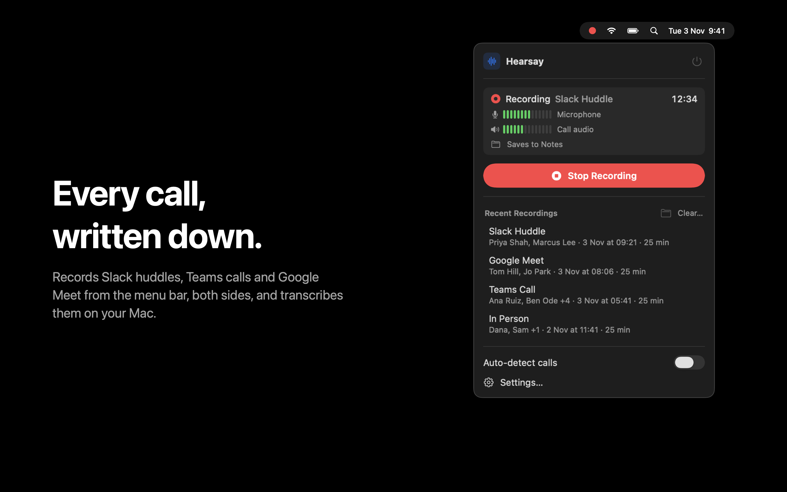
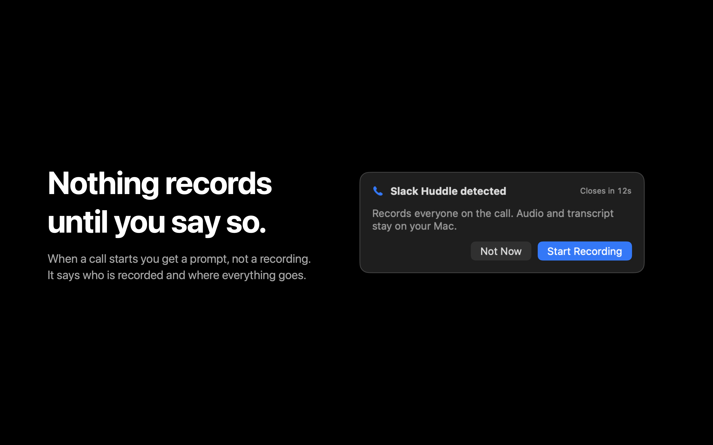
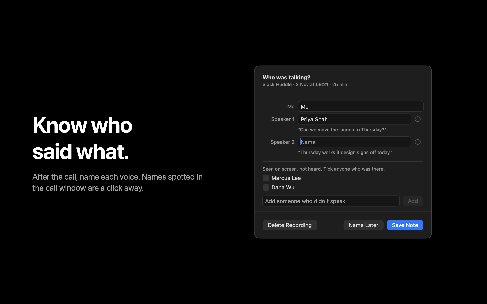
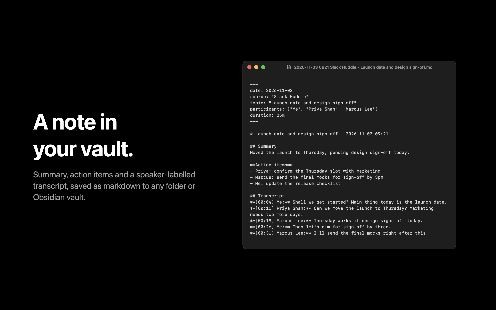
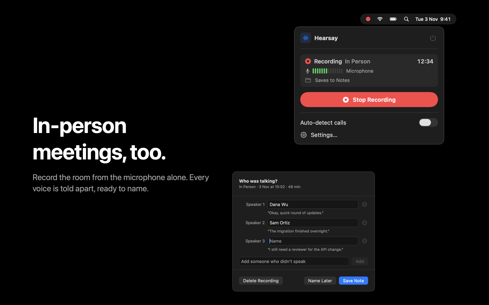
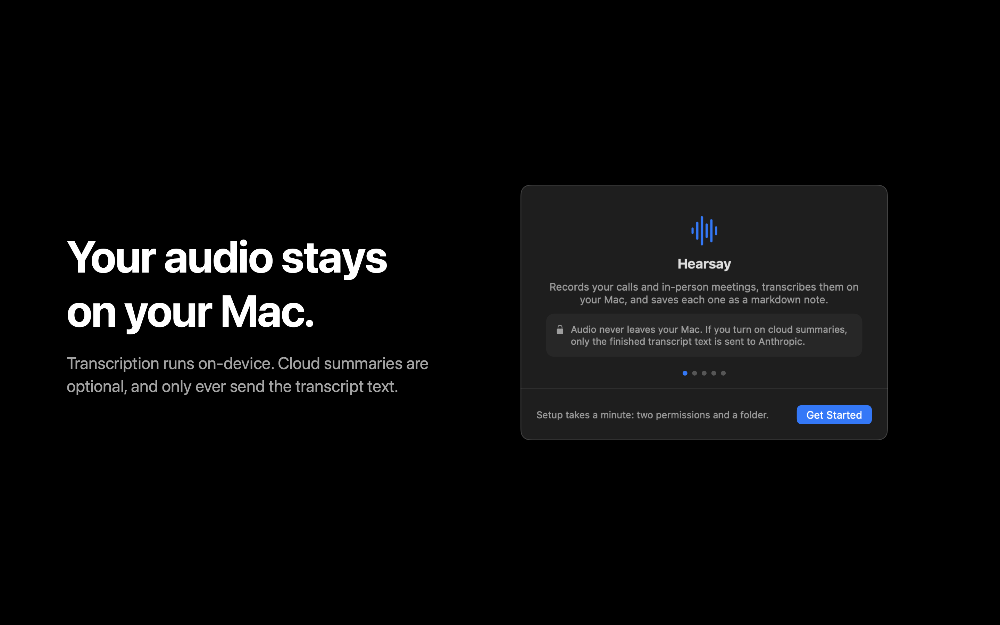

# Hearsay

macOS menu-bar app that detects Slack huddles / Teams calls / Google Meet (in the browser), records both sides, transcribes locally with WhisperKit, and writes a markdown note to your Obsidian vault. It also records in-person meetings from the laptop microphone alone.

<p>






</p>

See [DESIGN.md](DESIGN.md) for the full design and [PRODUCT.md](PRODUCT.md) for the product overview.

## Requirements

- Apple Silicon, macOS 14+
- Xcode 16+ / Swift 6 toolchain

## Build & run

```sh
./Scripts/setup-signing.sh   # once per machine
./Scripts/bundle.sh release
open build/Hearsay.app
```

`bundle.sh` compiles the executable, wraps it in a `.app`, and signs it with the hardened runtime via `Scripts/sign.sh`.

To walk through the setup guide again on a Mac that's already set up, launch with `open build/Hearsay.app --args -showSetupGuide YES`. It applies to that launch only.

### Screenshots

```sh
./Scripts/screenshots.sh            # writes build/screenshots/
./Scripts/appstore-screenshots.sh   # App Store images (2880 x 1800) into docs/appstore/, shown above
open build/screenshots/index.html
```

Renders every surface (menu, floating panel, call prompt, participant review, onboarding, Settings) in its main states, light and dark, plus a contact sheet. It runs as a test against throwaway fixtures, offscreen, so it needs no permissions and never touches your settings, history, recordings or API key. Scenes live in `Tests/HearsayTests/Screenshots/ScreenshotCatalog.swift`; add one there when you add a state. The App Store frames (headline beside the real views, rendered from the same fixtures) live in `AppStoreScreenshots.swift` beside it. Switches render with their unfocused grey track even when on (the knob still shows the state).

`setup-signing.sh` creates a self-signed "Hearsay Local Signing" certificate in the login keychain. Every build signed with it gets the same designated requirement (bundle id plus certificate), so macOS keeps Microphone and Screen Recording grants across rebuilds. Without it, `sign.sh` falls back to ad-hoc signing, which ties grants to the binary hash and re-prompts after every build. Override the identity with `SIGN_IDENTITY="..."`. The certificate is only meant for local builds: other Macs still need a Developer ID signature and notarization.

On first launch a setup guide walks through the permissions and the notes folder:

- **Microphone**: records your side, and the whole room for in-person meetings.
- **Screen Recording**: required for ScreenCaptureKit to capture the other participants' audio. Only calls need it, so the guide lets you skip it and still record in person. macOS only applies it after a relaunch, so once it's requested the guide offers *Open Settings* and *Relaunch Now*, and resumes where it left off.
- **Accessibility** (optional): detects Google Meet tabs and reads participant names off the call window. The guide's last step asks for it when you turn on auto-detect; it's also in Settings under Permissions.

The guide ends by opening the menu once, so you can see where the app lives (it has no Dock icon). Esc or the close button leaves it unfinished; the menu still offers any missing step.

## Usage

1. Click the waveform menu-bar icon.
2. Choose your **Notes folder** (your Obsidian vault, or any folder) when the setup guide asks, or later in **Settings…** under Notes, where you can also pick the **Transcription accuracy** (the Whisper model: `small`, labelled Accurate, by default; `large-v3` Most accurate; `tiny` Fastest). Transcription is English only.
3. **Manual:** click *Record a Call* (both sides) / *Stop Recording*, or *In Person* beside it for an ad-hoc in-person meeting, which captures the microphone only. Without Screen Recording, the only button is *Record in Person* and auto-detect is off.
4. **Auto:** toggle *Auto-detect calls* (in the menu or Settings under General). When your mic goes live in a call (Slack or Teams in front, a browser with a live Google Meet tab, or Slack or Teams in the background using the mic itself), a prompt appears at the bottom-right with a 15 second countdown; click *Start Recording* to begin, or *Not Now*. If you do nothing, the prompt dismisses and nothing is recorded. If the last recording is still waiting for speaker names, *Start Recording* parks that one under Needs Attention to name later. The review window's *Name Later* (or Esc, or its close button) does the same. A detected call's recording stops when the call app stops playing audio for 12 seconds, or quits. (Its own mic can't signal the end: this app keeps the mic open while recording.)

   Google Meet detection uses Accessibility to spot a tab whose title carries a Meet meeting code (`abc-defg-hij`), so a browser that's merely open won't trigger a prompt. Allow Accessibility from the setup guide or Settings under Permissions; without it, Meet calls still record via *Record a Call* manually. Capture targets the host browser's audio, so audio from that browser's other tabs can bleed into the recording.

Notes are written as `YYYY-MM-DD HHMM <Source> - <Topic>.md` with YAML frontmatter and a `Me` / `Others` labeled transcript. The topic comes from the AI summary, so with summaries off (or failing) the name is just `YYYY-MM-DD HHMM <Source>.md`.

In-person recordings have no second track to tell you apart from everyone else, so every voice in the room is diarized into `Speaker 1`, `Speaker 2`, … and the review dialog lets you name each one. Naming a voice relabels it throughout the transcript; voices you leave unnamed keep their label and stay out of the participant list.

If diarization splits one person into two voices, the − next to a voice folds its lines into the nearest other call voice (never into `Me`), with Undo. Names read off the call window are listed as "Seen on screen, not heard" and start unticked, since a Slack window also shows channel names; only ticked ones reach the note.

## Layout

```
Sources/Hearsay/
├── App.swift                      MenuBarExtra UI
├── Components.swift               shared Caution, IconButton, FolderChoice, RelaunchButton, Copy
├── Presentation.swift             shared names and symbols, VoiceOver Announcer
├── AppCoordinator.swift           wires detector → confirmation → recorder
├── Settings.swift                 model, vault (bookmark), toggles
├── SettingsView.swift             settings pane UI
├── Onboarding.swift               first-run setup guide
├── PermissionsManager.swift       microphone / screen-recording / accessibility status
├── Keychain.swift                 secure storage for the Anthropic API key
├── ParticipantReview.swift        post-recording dialog: name each voice, confirm the roster
├── Capture/                       RecordingController, System/Mic capture, Session
├── Transcription/                 WhisperKit service, merge, segment model, Diarizer
├── RecordingControlPanel.swift    floating timer / stop panel while recording
├── FloatingPanel.swift            shared setup for the floating panels
├── Summary/Summary.swift          Ollama / Claude summarizers
├── Pipeline/                      NotePipeline (post-recording sequence), Roster (voice → name)
├── Output/                        MarkdownWriter (note rendering), RecordingHistory,
                                   AudioArchiver + AudioFilenameFormatter (kept audio), FileNaming
└── Detection/                     CallDetector + CallActivityMonitor + AudioProcesses (Core Audio),
                                   BrowserCallDetector (Meet tab) + ParticipantDetector over AccessibilityTree,
                                   ConfirmationController
```

## Status

- ✅ Phase 1 — two-track capture (ScreenCaptureKit + AVAudioEngine)
- ✅ Phase 2 — local transcription + markdown output
- ✅ Phase 3 — auto-detect with confirmation
- ✅ Phase 4 — AI summary (local Ollama / cloud Claude), recording history, SpeakerKit diarization
- ✅ Phase 5 — per-app audio capture (records only the call app) + reliable huddle-end detection via Core Audio per-process output
- ✅ Phase 6 — best-effort participant detection (Accessibility + Vision OCR) with a post-recording review dialog to confirm/correct the roster
- ✅ Phase 7 — browser call support: auto-detect Google Meet via an Accessibility tab-title check and capture the host browser's audio
- ✅ Phase 8 — in-person meetings: mic-only capture with no Screen Recording requirement, forced diarization of the room, and per-voice naming in review

## Optional features

- **AI summary** — toggle in Settings under Summary. *Local* uses [Ollama](https://ollama.com) on `localhost:11434` (set the model name; default `llama3.2`). *Cloud* uses the Anthropic API (`claude-opus-5-5`) — paste an API key (stored in the macOS Keychain). A "## Summary" + action-items section is prepended to each note, and the summary's one-line topic titles the note and its filename. The summary runs after you confirm participants, so it uses real names, and a call you delete is never summarized. If the summary can't be made (Ollama not running, no API key), the note says why instead of silently leaving it out.
- **Separate remote speakers** — toggle in Settings under Notes to run SpeakerKit diarization on the system-audio track, relabeling `Others` as `Speaker 1`, `Speaker 2`, … Downloads a diarization model on first use. In-person recordings always diarize, whatever this is set to, because it is the only thing separating the voices in the room.
- **Keep audio**: in Settings under Audio, off by default, so audio is deleted once the note is saved. Turn it on and choose an audio folder to keep both tracks, named by the filename format (`{date} {time} {source} {track}`). If the copy fails, the audio stays in Application Support and the menu says so.
- **Recent Recordings** — the last five notes (three while Needs Attention is showing) appear in the menu, each row opening its note, with a button for the notes folder and *Clear…* for the list; history persists in `~/Library/Application Support/Hearsay/history.json`. Removing an entry only removes it from the list; it never deletes files.
- **Needs Attention** — a recording that never became a note (processing failed or was cancelled, or the app crashed or quit mid-call) is kept and listed under *Needs Attention* in the menu, including after a relaunch. Make a note from each one, *Make All Notes*, or delete it. Each recording folder carries a `session.json` progress marker (`recording` → `recorded` → `transcribed` → `noted`) and, once transcription finishes, a `transcript.json`, so a retry after a crash in review or summary skips straight past transcription. Folders from before the marker existed are recovered from their name and audio.
